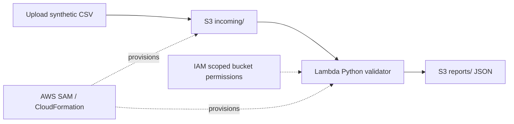

# Deploy the serverless CSV validator

**Status: code prepared; live AWS deployment has not been verified.**
Use only synthetic records. AWS services may incur charges.

## Architecture

## Why these choices?
- **S3** holds CSV inputs and JSON outputs; prefix filter avoids self-triggered recursion.
- **Lambda** runs on S3 object-created events without provisioning a server.
- **IAM** grants bucket-scoped read and write permissions.
- **SAM** generates CloudFormation-managed resources and is reproducible.

## Setup and test
1. Configure AWS credentials with sufficient permissions and set a spending alert.
2. Install AWS CLI and SAM CLI; choose a region.
3. Run `python -m pip install -r requirements.txt` then `python -m pytest -v`.
4. Validate template with `sam validate --lint` (requires cfn-lint) and run `sam build`.
5. Run `sam deploy --guided`, inspect the CloudFormation change set, approve creation only after reviewing costs and permissions.
6. Copy the output bucket name from CloudFormation outputs.
7. Upload `patients.csv` to `s3://YOUR_BUCKET/incoming/patients.csv` using AWS CLI or Console.
8. Open `s3://YOUR_BUCKET/reports/patients.json` and verify counts against input. Review CloudWatch Logs for Lambda errors.
9. Save a redacted execution screenshot, architecture diagram and deployment details.
10. Delete test objects, then run `sam delete` and confirm resources were removed.

## Known limitations
This demonstration has no authentication layer for end users, no dead-letter queue/retries beyond S3/Lambda defaults, no lifecycle policy or monitoring alarms, no CSV row limit beyond object size, and no production PHI security controls. Do not process actual patient records.

## Résumé evidence checklist
- [ ] Successful deployment and stack outputs saved
- [ ] Input CSV successfully triggers Lambda
- [ ] JSON report verified in S3
- [ ] IAM permissions reviewed
- [ ] CloudFormation resources torn down
- [ ] README screenshots linked
