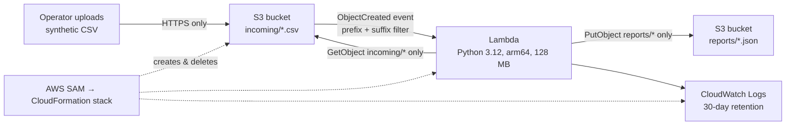

# Serverless CSV validator — architecture and deployment

**Status:** template and code tested locally; **live AWS deployment not yet verified.** Evidence goes in `docs/evidence/` only after a real run. Synthetic data only.

## Architecture



One bucket, two prefixes. The event filter only fires for `incoming/*.csv`, and the function only writes to `reports/`, so a report can never re-trigger the function (no recursive loop).

## Design decisions

| Decision | Why | Trade-off |
|---|---|---|
| S3 event → Lambda (async) | No servers, pay per upload, scales automatically | Events are at-least-once; a file can occasionally be processed twice (harmless here: same report is overwritten) |
| Explicit bucket name `<stack>-data-<account>` | Breaks the circular dependency in the original template (function policy ↔ bucket notification) | Stack name must be lowercase and globally-unique-ish |
| Inline IAM policy: `GetObject` on `incoming/*`, `PutObject` on `reports/*` | Least privilege. The original SAM policy templates also granted ACL and lifecycle changes | Adding features later requires editing the policy |
| `head_object` before download | Rejects oversized files without reading them | One extra S3 request per file |
| Bad files → `reports/<name>.error.json` | The operator sees why a file failed; bad data isn't retried pointlessly | No alerting — someone must look |
| AWS/infrastructure errors re-raised, `MaximumRetryAttempts: 1` | Transient failures get one retry; logged in CloudWatch | After the retry the event is dropped (no dead-letter queue) |
| arm64 + 128 MB + 30 s timeout | Cheapest Lambda configuration that comfortably handles a 2 MB CSV | Not tuned with real load tests |
| Lifecycle expiry + log retention (default 30 days) | Demo data and logs don't accumulate cost forever | Objects disappear automatically — not an archive |
| Optional reserved concurrency | Hard cap on parallel runs if your account allows it | New accounts usually can't reserve (account limit of 10) |

## Failure handling

| What goes wrong | What happens |
|---|---|
| Wrong columns, non-UTF-8, > 2 MB, > 10,000 rows | `reports/<name>.error.json` with `status: rejected` and a reason |
| Bad value in a row (e.g. `age=unknown`) | That row is marked invalid in the normal report; other rows still processed |
| Upload to another prefix or non-CSV | Ignored by the event filter (and by a second check in code) |
| S3 permission/network error | Exception → CloudWatch Logs → Lambda retries once → dropped |

## Security limitations (honest list)

- **Not for real patient data.** No HIPAA/BAA setup, no customer-managed KMS keys, no access logging, no CloudTrail data events.
- **No end-user authentication.** Uploading requires your own AWS credentials; there's no web upload page.
- **No dead-letter queue or alarms.** Repeated failures are only visible in logs.
- **SSE-S3 encryption** (AWS-managed keys) — fine for a demo; regulated data would use SSE-KMS with key policies.
- Protections that *are* in place: all public access blocked, ACLs disabled, HTTPS enforced by bucket policy, encryption at rest, scoped IAM, data auto-expires.

## Expected cost

For a handful of demo uploads of small CSVs, Lambda, S3 and CloudWatch charges are expected to round to **$0.00–$0.01** (Lambda request and compute charges are per millisecond; storage is a few KB). This is an estimate, not a measurement. Create an AWS Budget alert (e.g. $5) before deploying, and delete the stack afterwards.

## Deploy and verify (Windows PowerShell)

Prerequisites: AWS CLI v2, [AWS SAM CLI](https://docs.aws.amazon.com/serverless-application-model/latest/developerguide/install-sam-cli.html), Python 3.12, and `aws sso login` completed.

```powershell
pip install -r requirements-dev.txt
python -m pytest -v                      # 16 tests, no AWS calls
sam validate --lint                      # template check (uses cfn-lint)
sam build
sam deploy --stack-name pdv-demo --region us-east-1 --capabilities CAPABILITY_IAM --resolve-s3 --confirm-changeset
```

Review the change set before typing `y`. Then trigger the pipeline and capture evidence:

```powershell
python scripts/demo_upload.py --stack pdv-demo --region us-east-1 --file patients.csv
python scripts/demo_upload.py --stack pdv-demo --region us-east-1 --file samples/bad_columns.csv
aws logs tail /aws/lambda/pdv-demo-validator --since 15m --region us-east-1
```

Each run writes a redacted `docs/evidence/<name>_run.json`. Screenshot the S3 `reports/` folder and the CloudWatch log lines (crop out account IDs).

## Tear down

```powershell
aws s3 rm s3://pdv-demo-data-<ACCOUNT_ID> --recursive   # bucket must be empty first
sam delete --stack-name pdv-demo --region us-east-1
```

`--resolve-s3` also creates a small SAM artifacts bucket (`aws-sam-cli-managed-default`); it can be left (pennies) or deleted from the CloudFormation console.

## Résumé evidence checklist
- [ ] Stack deployed; outputs saved (redacted)
- [ ] `patients.csv` upload produced `reports/patients.json`
- [ ] `bad_columns.csv` produced `reports/bad_columns.error.json`
- [ ] CloudWatch log lines captured
- [ ] Stack deleted and confirmed gone
